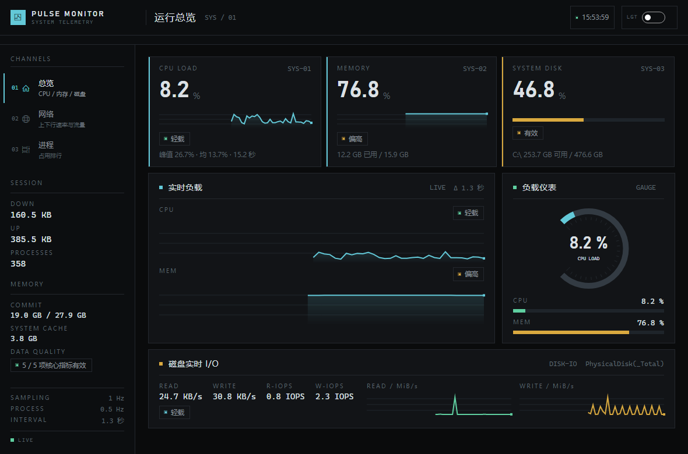
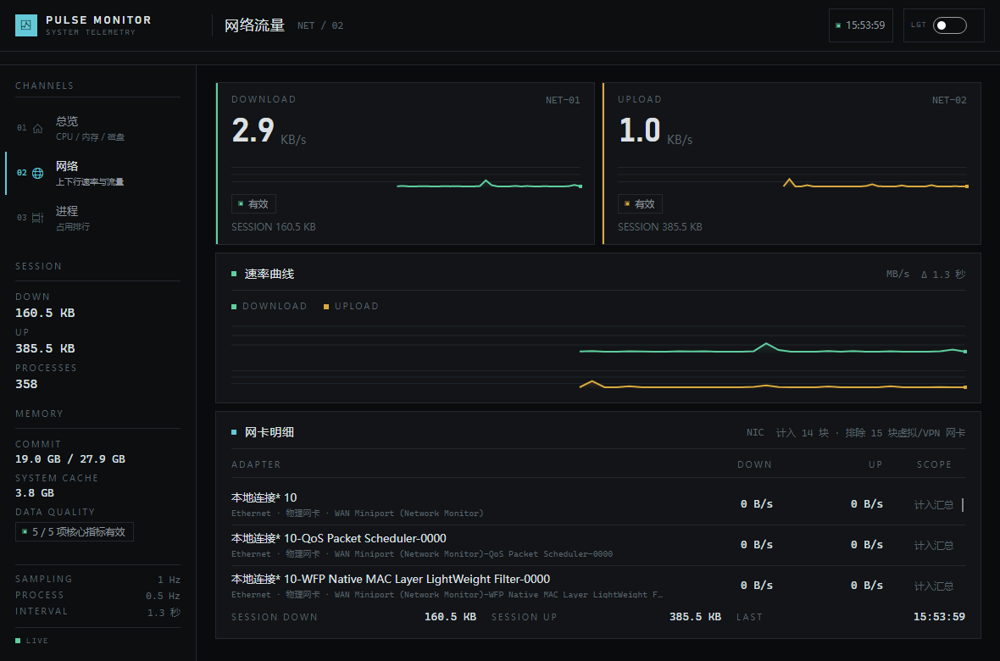
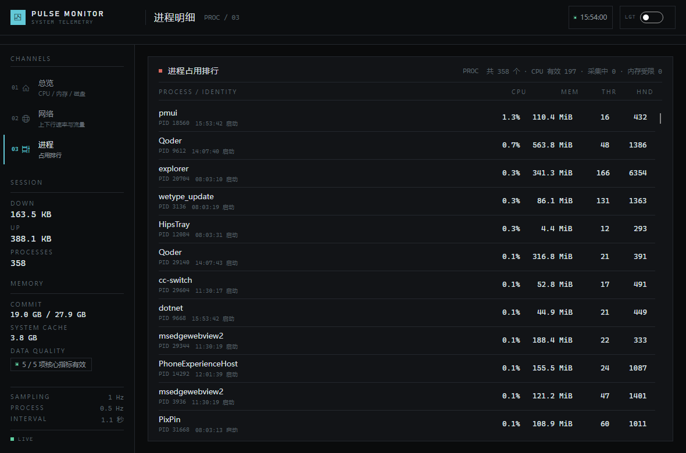
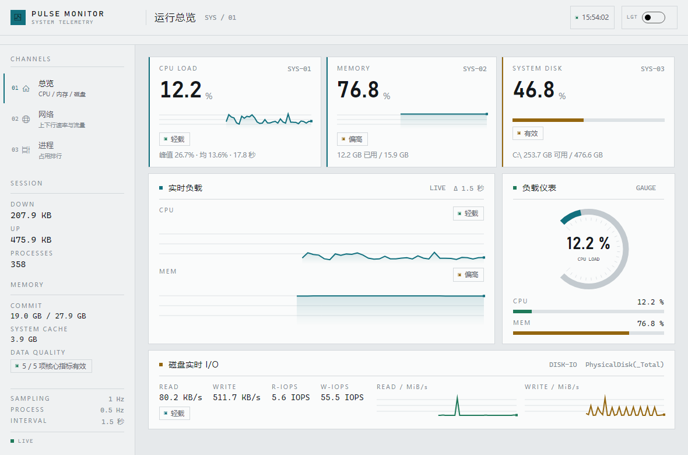

# PulseMonitor

Windows 系统性能监控终端。Avalonia 12 + .NET 10，MVVM 架构，界面采用仪表控制台风格。

采集 CPU、内存、系统盘容量、**物理磁盘实时 I/O**、网络上下行速率与进程占用，全部指标带可信度状态：无效读数显示 `N/A` 而不是 `0`。



## 特性

- **三页视图**：运行总览 / 网络流量 / 进程明细，切页保留滚动位置与采样状态
- **磁盘实时 I/O**：读写速率与 IOPS 来自 Windows PDH，附双曲线
- **明暗双主题**：顶栏开关即时换肤，所有颜色走 `DynamicResource`，界面不重建
- **60 点趋势曲线**：自绘控件，按时间和点数双上限裁剪；断档超过 3 秒自动断开
- **网络区分物理与虚拟网卡**：汇总只计入物理网卡，避免 VPN / Hyper-V 重复计数；
  单块网卡采样失败时按可用网卡汇总，并明确标注是「部分统计」
- **进程排行虚拟化**：300+ 进程也只创建视口内的行容器，刷新时增量复用
- **进程路径缓存**：可执行路径按 PID + 启动时间只读一次，减少系统调用

| 网络流量 | 进程明细 |
| --- | --- |
|  |  |

浅色主题：



## 环境要求

- Windows 10 / 11
- [.NET 10 SDK](https://dotnet.microsoft.com/download)

监控能力依赖 Windows API（`GetSystemTimes`、`GlobalMemoryStatusEx`、`GetPerformanceInfo`）与 PDH（`pdh.dll`），其它平台无法运行采集层。

## 运行

```bash
dotnet run --project PulseMonitor.csproj
```

发布独立可执行文件：

```bash
dotnet publish PulseMonitor.csproj -c Release -r win-x64 --self-contained false
```

运行测试：

```bash
dotnet test Tests/PulseMonitor.Tests.csproj
```

## 界面结构

```
Window
├── 顶栏        品牌 / 当前页标题与通道代号 / 最近更新 / 主题开关
├── 量程尺      全宽刻度线
└── Grid
    ├── SidebarView   通道导航 + 会话读数 + 采样遥测
    └── Carousel      三个页面，CrossFade 翻页
```

侧边栏 `ListBox.SelectedIndex` 与 `Carousel.SelectedIndex` 双向绑定到同一个 `SelectedIndex`，切页零代码；三个页面共享同一个 `DashboardViewModel`，数据只采集一次。

## 项目结构

```
Models/       不可变快照 + MetricSample<T>（值 + SampleStatus + 时间戳 + 错误）
Services/     CPU / 内存 / 磁盘容量 / 磁盘 I/O（PDH）/ 网络 / 进程采集
ViewModels/   Shell（页面索引）、Dashboard（采样循环与全部展示文案）、行与历史缓冲
Views/        三个页面 + 侧边栏
Controls/     自绘与模板控件：TrendChart / GaugeMeter / TickRule / MeterBar 等
Themes/       设计令牌、明暗色板、控件 ControlTheme、数据模板、类样式
Tests/        xUnit：采样状态、速率差分、历史缓冲、网络完整性、UI 性能回归
```

### 设计令牌

| 令牌 | 值 | 用途 |
| --- | --- | --- |
| `DisplayFontFamily` | Bahnschrift | 大号读数与标题（DIN 风格） |
| `MonoFontFamily` | Cascadia Mono | 数据、编号、时间戳 |
| `RadiusCard` 等 | 2px | 工业面板只保留消毛刺的微圆角 |
| `BrushAccent` | `#63C9D8` | 系统 / 主通道（青） |
| `BrushGreen` | `#5FCFA0` | 正常（绿） |
| `BrushAmber` | `#D9A93F` | 偏高（琥珀） |
| `BrushRose` | `#D9695F` | 过载（朱红） |

## 数据可信度

每个指标都是 `MetricSample<T>`，只有 `Status == Valid` 时数值才会进入界面与曲线：

| 状态 | 含义 | 界面表现 |
| --- | --- | --- |
| `Initializing` | 已建立基准，尚无差值 | `采集中` |
| `Valid` | 有效读数 | 正常数值 |
| `CounterReset` | 累计计数器回退或处理器组变化 | `重置` |
| `Unavailable` | 接口不可用或权限不足 | `N/A` |
| `Stale` | 超过 3 秒没有新样本 | `数据已过期` |
| `Invalid` | 有读数但结果不可信 | `采样无效` |

采样失败只影响对应指标，不会让整个快照抛异常。

## 采样策略

- 系统指标（CPU / 内存 / 磁盘容量 / 磁盘 I/O / 网络）每 1 秒一次
- 进程列表在进程页可见时每 2 秒一次，其它页面每 5 秒一次
- CPU 与进程 CPU 都用两次累计值差分，速率基于实际单调时钟间隔而非假定 1 秒
- 磁盘 I/O 使用 PDH 的英文计数器名（`PhysicalDisk(_Total)`），不受系统语言影响；
  速率型计数器首次采样返回「采集中」
- 多处理器组（> 64 逻辑核）逐组求和；无法覆盖全部处理器组时明确返回不可用

## 已知限制

- 仅支持 Windows（磁盘 I/O 需要 x64）
- 磁盘 I/O 统计的是所有物理磁盘合计，尚未拆分到单块磁盘
- 暂无 GPU、温度、风扇等传感器读数
- 进程页暂不显示进程级磁盘读写（需 `GetProcessIoCounters`，口径与物理磁盘吞吐不同）

## 许可

暂未指定开源许可。
